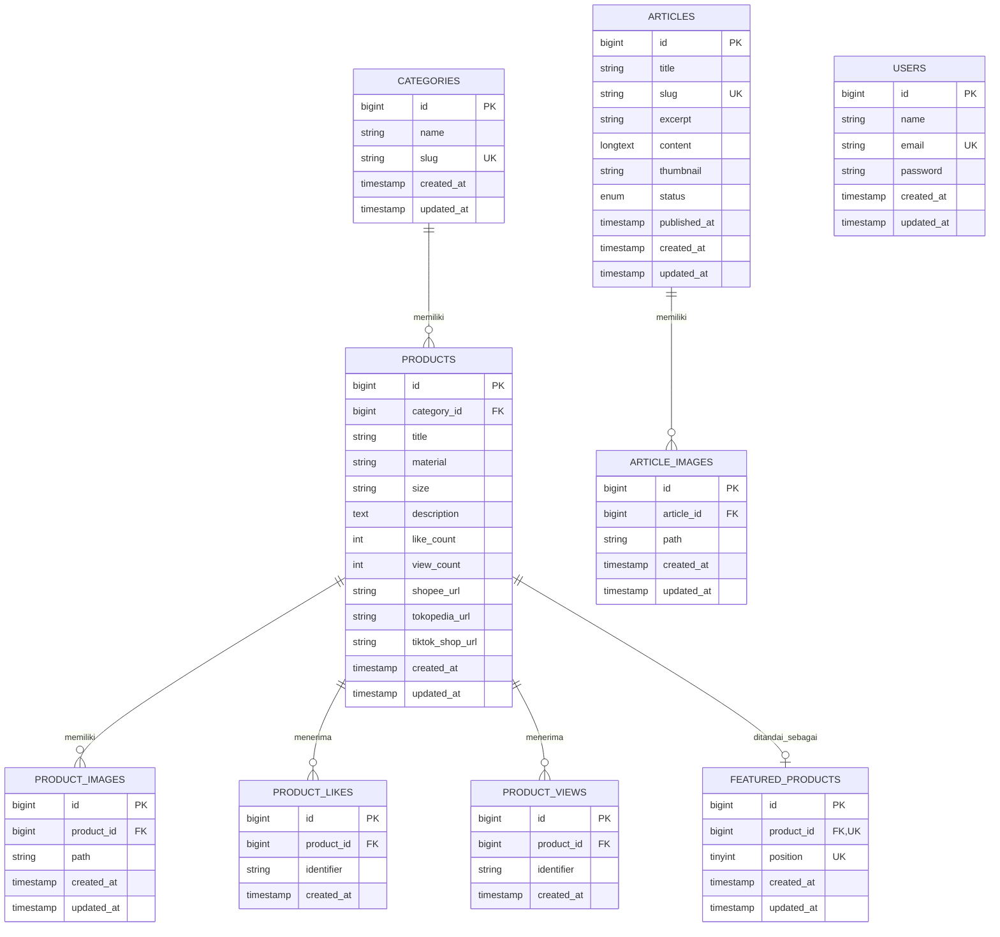

# Leauxury Industrial

Platform katalog produk dan content management system untuk Leauxury Industrial, sebuah brand furniture dan kerajinan marmer bergaya industrial-premium. Sistem ini terdiri dari REST API backend dan Single Page Application frontend yang saling terpisah, dirancang untuk menampilkan katalog produk kepada publik sekaligus menyediakan panel administrasi bagi pemilik bisnis untuk mengelola produk, artikel, dan memantau performa katalog.

## Daftar Isi

- [Ringkasan Bisnis](#ringkasan-bisnis)
- [Arsitektur Sistem](#arsitektur-sistem)
- [Tech Stack](#tech-stack)
- [Struktur Basis Data](#struktur-basis-data)
- [Entity Relationship Diagram](#entity-relationship-diagram)
- [Alur Autentikasi](#alur-autentikasi)
- [Fitur Publik](#fitur-publik)
- [Fitur Admin](#fitur-admin)
- [Desain API](#desain-api)
- [Keamanan](#keamanan)
- [Performa](#performa)
- [Struktur Proyek](#struktur-proyek)

## Ringkasan Bisnis

Leauxury Industrial menjual produk furniture dan kerajinan berbahan marmer serta material industrial lainnya. Sebelum sistem ini dibangun, katalog produk tidak memiliki representasi digital yang terstruktur, sehingga calon pembeli kesulitan menemukan informasi produk secara sistematis dan pemilik bisnis tidak memiliki data mengenai produk mana yang paling diminati.

Sistem ini menjawab kebutuhan tersebut melalui dua sisi:

Sisi publik menyediakan katalog produk yang dapat difilter berdasarkan kategori, dicari berdasarkan kata kunci, dan dilihat detailnya lengkap dengan galeri foto. Pengunjung dapat memberikan tanda suka pada produk tanpa perlu membuat akun, dan setiap produk memiliki tombol kontak langsung menuju WhatsApp dengan pesan otomatis yang menyertakan tautan produk yang dimaksud, sehingga admin dapat mengidentifikasi produk mana yang ditanyakan calon pembeli. Produk juga dapat ditautkan langsung ke marketplace eksternal seperti Shopee, Tokopedia, dan TikTok Shop apabila tersedia. Selain katalog produk, terdapat pula bagian artikel yang berfungsi sebagai media edukasi dan pemasaran konten seputar produk industrial dan perawatan marmer.

Sisi admin menyediakan panel tertutup bagi pemilik bisnis untuk mengelola seluruh konten. Admin dapat menambah, mengubah, dan menghapus produk beserta foto-fotonya, mengatur kategori produk, menentukan tiga produk unggulan yang ditampilkan di galeri utama, serta mengelola artikel dengan status draf dan terbit. Admin juga memiliki akses ke dashboard analitik yang menampilkan statistik jumlah suka dan tayangan per produk, termasuk grafik pertumbuhan interaksi dari waktu ke waktu untuk produk tertentu yang dipilih.

Karena bisnis ini hanya memiliki satu pihak yang mengelola sistem, arsitektur otorisasi sengaja dirancang sederhana dengan satu peran administrator saja, tanpa sistem multi-peran yang kompleks. Akun admin dibuat melalui basis data secara langsung dan tidak tersedia pendaftaran melalui antarmuka publik.

## Arsitektur Sistem

Sistem menggunakan arsitektur backend dan frontend yang terpisah sepenuhnya. Backend berfungsi murni sebagai penyedia data melalui REST API dan tidak merender tampilan apa pun, sementara frontend berupa Single Page Application yang mengonsumsi API tersebut dan menangani seluruh logika presentasi di sisi klien.

Pemisahan ini dipilih karena sistem membutuhkan interaktivitas tinggi pada sisi publik, seperti pencarian dan filter produk secara real-time, pemberian suka tanpa memuat ulang halaman, serta dashboard admin dengan visualisasi data dinamis. Pendekatan API-first juga memberi keleluasaan apabila di kemudian hari backend perlu melayani klien lain selain aplikasi web, seperti aplikasi mobile.

Alur permintaan data secara umum berjalan sebagai berikut. Frontend Vue mengirim permintaan HTTP ke endpoint REST API menggunakan Axios. Permintaan tersebut diterima oleh Laravel melalui lapisan route, kemudian diproses melalui middleware yang relevan seperti autentikasi dan pembatasan laju permintaan, dilanjutkan ke controller yang menjalankan validasi melalui form request, mengambil atau memodifikasi data melalui Eloquent ORM, dan mengembalikan hasil dalam format JSON yang telah distandarkan melalui API Resource. Frontend kemudian merender hasil tersebut secara reaktif ke antarmuka pengguna.

## Tech Stack

Backend dibangun menggunakan Laravel dengan basis data MySQL, autentikasi berbasis token menggunakan Laravel Sanctum, serta REST API sebagai antarmuka komunikasi. Validasi permintaan ditangani melalui Form Request, format respons distandarkan melalui API Resource, dan pemrosesan gambar produk menggunakan Intervention Image dengan keluaran format WebP untuk efisiensi ukuran berkas. Konten artikel disaring dari kemungkinan muatan berbahaya menggunakan HTML Purifier sebelum disimpan.

Frontend dibangun menggunakan Vue 3 dengan Composition API, Vue Router untuk navigasi antar halaman, dan Axios sebagai klien HTTP. Manajemen state autentikasi menggunakan composable sederhana tanpa pustaka manajemen state tambahan, mengingat kompleksitas state pada aplikasi ini tidak memerlukannya. Antarmuka disusun menggunakan Tailwind CSS dengan pendekatan desain glassmorphism dan palet warna yang mencerminkan citra material alami seperti marmer dan travertine. Visualisasi data pada dashboard admin menggunakan Chart.js melalui pembungkus Vue Chartjs.

Ringkasan teknologi yang digunakan adalah sebagai berikut.

Backend: Laravel, MySQL, Laravel Sanctum, Intervention Image, HTML Purifier

Frontend: Vue 3, Vue Router, Axios, Tailwind CSS, Chart.js

Infrastruktur pengembangan: Vite sebagai build tool frontend, Cloudflare Tunnel untuk eksposur sementara selama fase pengujian dengan klien.

## Struktur Basis Data

Sistem menggunakan sembilan tabel utama yang saling berelasi. Tabel users berfungsi ganda sebagai representasi akun administrator, mengingat sistem hanya memiliki satu peran pengguna sehingga tidak diperlukan tabel administrator terpisah.

Tabel categories menyimpan kategori produk dan memiliki relasi satu ke banyak terhadap tabel products. Penghapusan kategori yang masih memiliki produk di dalamnya dicegah secara eksplisit di tingkat aplikasi untuk menghindari kehilangan data secara tidak sengaja.

Tabel products menjadi entitas utama dengan kolom penghitung like_count dan view_count yang disimpan langsung sebagai kolom terpisah dari data mentah interaksi, bertujuan mempercepat kueri pengurutan dan agregasi tanpa perlu menghitung ulang dari tabel log setiap kali diminta. Tabel ini juga menyimpan tautan opsional menuju marketplace eksternal.

Tabel product_images menyimpan relasi satu produk ke banyak gambar, dengan penghapusan berantai apabila produk induk dihapus, mengingat gambar tidak memiliki makna tanpa produk yang direpresentasikannya.

Tabel product_likes dan product_views mencatat setiap peristiwa suka dan tayangan secara individual, digunakan sebagai data mentah untuk analitik pertumbuhan dari waktu ke waktu. Tabel product_likes memiliki batasan unik gabungan antara identifier pengguna dan produk untuk mencegah pemberian suka berulang, sementara tabel product_views sengaja tidak memiliki batasan tersebut karena satu pengunjung yang melihat produk yang sama berkali-kali tetap dianggap sebagai minat yang valid.

Tabel featured_products merepresentasikan pemilihan produk unggulan oleh admin, dirancang sebagai tabel terpisah dengan kolom posisi eksplisit alih-alih kolom boolean sederhana pada tabel produk, karena kebutuhan bisnis mengharuskan urutan tampilan yang dapat diatur dan dibatasi maksimal tiga produk.

Tabel articles menyimpan konten artikel dengan status draf dan terbit, serta kolom published_at yang terpisah dari waktu pembuatan untuk mendukung penjadwalan penerbitan konten.

## Entity Relationship Diagram



Catatan mengenai batasan pada level basis data yang tidak sepenuhnya tergambar dalam diagram di atas. Kolom identifier pada tabel product_likes memiliki batasan unik gabungan bersama product_id untuk mencegah duplikasi suka dari sumber yang sama. Kolom position pada tabel featured_products memiliki batasan unik untuk mencegah dua produk menempati posisi tampilan yang sama. Relasi antar tabel produk turunan menggunakan penghapusan berantai, sementara relasi kategori ke produk menggunakan pembatasan penghapusan yang mengharuskan produk dipindahkan atau dihapus terlebih dahulu sebelum kategorinya dapat dihapus.

## Alur Autentikasi

Autentikasi administrator menggunakan Laravel Sanctum dengan pendekatan token, bukan sesi berbasis cookie, mengingat backend dan frontend berjalan pada domain yang berbeda selama masa pengembangan dan berpotensi tetap terpisah pada tahap produksi.

Proses dimulai ketika admin mengirimkan kredensial melalui formulir masuk. Backend memvalidasi kredensial tersebut, dan apabila valid, menghasilkan token akses yang dikembalikan kepada frontend. Frontend menyimpan token tersebut pada penyimpanan lokal peramban dan menyertakannya pada setiap permintaan berikutnya menuju endpoint yang memerlukan otorisasi melalui header Authorization. Backend memvalidasi keabsahan token pada setiap permintaan melalui middleware, dan menolak permintaan dengan token yang tidak valid atau kedaluwarsa.

Halaman administrasi pada sisi frontend dilindungi melalui penjaga navigasi yang memeriksa keberadaan token sebelum mengizinkan akses ke rute yang memerlukan autentikasi. Perlindungan ini bersifat pengalaman pengguna semata, sementara keamanan sesungguhnya tetap ditegakkan oleh backend pada setiap permintaan data.

Endpoint autentikasi dilindungi pembatasan laju permintaan untuk mencegah upaya peretasan kredensial secara paksa, membatasi jumlah percobaan masuk dalam rentang waktu tertentu berdasarkan alamat IP.

## Fitur Publik

Pengunjung dapat menjelajahi katalog produk lengkap dengan kemampuan pencarian berdasarkan judul, penyaringan berdasarkan kategori, dan pagination hasil. Setiap produk menampilkan galeri foto, informasi material dan ukuran, deskripsi lengkap, jumlah suka dan tayangan, serta tautan menuju marketplace eksternal apabila tersedia.

Pemberian suka pada produk tidak mensyaratkan pembuatan akun. Sistem menghasilkan pengenal anonim yang disimpan pada penyimpanan lokal peramban pengunjung, digunakan sebagai penanda untuk mencegah pemberian suka berulang pada produk yang sama dari peramban yang sama. Pendekatan ini dipilih setelah mempertimbangkan trade-off antara kemudahan penggunaan dan ketegasan pencegahan duplikasi, mengingat interaksi suka pada produk furniture bukan merupakan transaksi yang memerlukan tingkat keamanan setara data finansial.

Galeri utama menampilkan dua kategori produk unggulan, yaitu produk pilihan admin yang ditentukan secara manual dengan urutan yang dapat diatur, serta produk dengan jumlah suka terbanyak yang dihitung secara otomatis oleh sistem.

Setiap produk memiliki tombol kontak menuju WhatsApp yang menghasilkan pesan otomatis berisi nama produk beserta tautan langsung menuju halaman detail produk tersebut, memudahkan admin mengidentifikasi produk yang ditanyakan tanpa perlu klarifikasi tambahan dari calon pembeli.

Bagian artikel menampilkan daftar tulisan yang telah diterbitkan beserta detail lengkapnya, diakses melalui slug alih-alih pengenal numerik untuk kebutuhan keterbacaan tautan dan optimasi mesin pencari.

## Fitur Admin

Panel admin menyediakan pengelolaan penuh atas produk, meliputi pembuatan, pengubahan, dan penghapusan produk beserta banyak foto sekaligus. Admin juga dapat mengelola kategori produk, dengan pencegahan penghapusan kategori yang masih memiliki produk terkait.

Penentuan produk unggulan dilakukan melalui antarmuka pemilihan tiga slot dengan urutan yang dapat diatur, merefleksikan struktur data pada tabel featured_products.

Pengelolaan artikel mencakup pembuatan, pengubahan, penghapusan, serta pengaturan status draf dan terbit. Artikel dapat menyertakan gambar sampul utama beserta galeri gambar tambahan. Konten artikel disaring secara otomatis dari kemungkinan muatan skrip berbahaya sebelum disimpan ke basis data.

Dashboard analitik menampilkan ringkasan jumlah produk, artikel, total suka, dan total tayangan, dilengkapi visualisasi grafik batang untuk lima produk dengan suka dan tayangan terbanyak. Admin juga dapat memilih produk tertentu untuk melihat grafik pertumbuhan suka dan tayangan dari waktu ke waktu dalam rentang tujuh, tiga puluh, atau sembilan puluh hari terakhir, memungkinkan identifikasi tren minat terhadap produk secara lebih mendalam dibandingkan sekadar angka kumulatif.

## Desain API

API dipisahkan secara jelas antara endpoint publik yang dapat diakses tanpa autentikasi dan endpoint administratif yang memerlukan token valid. Endpoint publik mencakup pengambilan daftar dan detail produk, kategori, artikel, serta aksi pemberian suka dan pencatatan tayangan. Endpoint administratif mencakup seluruh operasi pengelolaan data yang memerlukan hak akses admin, dilindungi middleware autentikasi pada tingkat grup rute.

Validasi permintaan ditangani melalui kelas Form Request terpisah untuk setiap jenis operasi, memisahkan tanggung jawab validasi dari logika pengendali. Format respons distandarkan melalui API Resource untuk memastikan konsistensi struktur data yang dikembalikan kepada klien, termasuk penyembunyian kolom yang tidak relevan bagi konteks tertentu, seperti kolom konten lengkap artikel yang disembunyikan pada tampilan daftar untuk mengurangi ukuran muatan data.

## Keamanan

Setiap unggahan gambar divalidasi berdasarkan tipe MIME sesungguhnya, bukan sekadar ekstensi berkas, disertai batasan ukuran dan dimensi maksimal untuk mencegah unggahan berkas yang berpotensi disalahgunakan atau membebani penyimpanan secara berlebihan.

Konten artikel yang berpotensi mengandung markah HTML disaring melalui pustaka pembersih HTML sebelum disimpan, mencegah kemungkinan penyisipan skrip berbahaya yang dapat dieksekusi pada peramban pengunjung lain.

Pencegahan duplikasi data ditegakkan pada tingkat basis data melalui batasan unik, bukan semata mengandalkan pemeriksaan pada level aplikasi, mengingat kondisi permintaan yang terjadi secara bersamaan dapat melewati pemeriksaan aplikasi apabila tidak didukung batasan pada lapisan penyimpanan data.

Kebijakan berbagi sumber daya lintas asal dikonfigurasi secara eksplisit untuk membatasi asal permintaan yang diizinkan mengakses API, dan konfigurasi mass assignment pada setiap model membatasi kolom yang dapat diisi melalui permintaan eksternal untuk mencegah penyisipan nilai pada kolom yang tidak seharusnya dapat dikendalikan oleh pengguna.

## Performa

Relasi antar tabel dimuat menggunakan eager loading pada kueri yang melibatkan data terkait untuk menghindari masalah kueri berlebih yang umum terjadi pada penggunaan Eloquent ORM tanpa optimasi. Kolom yang sering digunakan sebagai kriteria pencarian atau pengurutan diberikan indeks pada tingkat basis data.

Endpoint yang menampilkan data dengan frekuensi perubahan rendah, seperti produk unggulan, menggunakan mekanisme cache dengan masa berlaku terbatas untuk mengurangi beban kueri berulang, disertai penghapusan cache secara eksplisit ketika data terkait diperbarui oleh admin.

Gambar yang diunggah melalui panel admin diproses secara otomatis melalui perubahan ukuran dan konversi ke format WebP untuk mengurangi ukuran berkas secara signifikan tanpa penurunan kualitas visual yang berarti. Berkas JavaScript pada frontend dipisahkan menjadi beberapa bagian berdasarkan rute halaman, memastikan pustaka yang hanya digunakan pada panel admin, seperti pustaka visualisasi grafik, tidak dimuat pada halaman publik yang tidak membutuhkannya.

## Struktur Proyek

Proyek terdiri dari dua direktori independen yang dijalankan sebagai proses terpisah selama pengembangan.

```
leauxury-backend/
    app/
        Http/
            Controllers/Api/       Pengendali untuk endpoint publik dan admin
            Requests/               Validasi permintaan
            Resources/              Pembentuk format respons JSON
            Middleware/             Middleware kustom
        Models/                     Model Eloquent dan relasi antar tabel
    database/
        migrations/                 Definisi struktur tabel
        seeders/                    Data awal termasuk akun admin
    routes/
        api.php                     Definisi seluruh endpoint REST API

leauxury-frontend/
    src/
        api/                        Konfigurasi klien HTTP
        components/                 Komponen dapat digunakan ulang
        composables/                Logika status bersama, termasuk autentikasi
        views/                      Halaman publik dan admin
        router/                     Definisi rute dan penjaga navigasi
```
